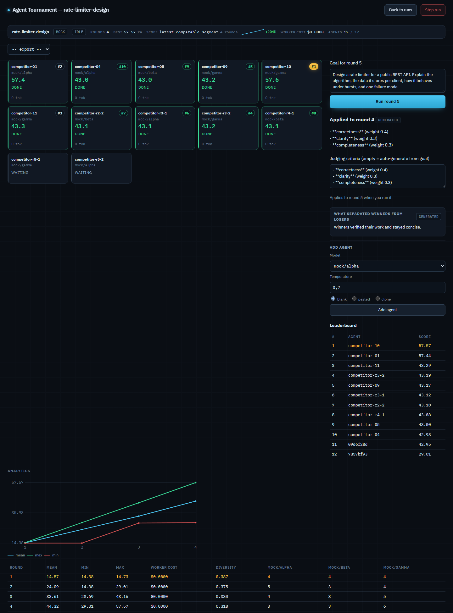
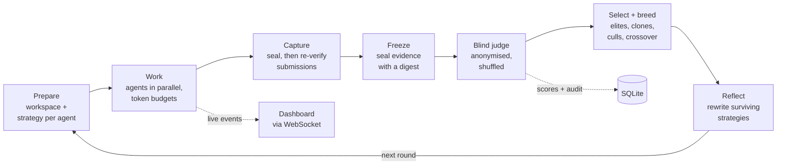

# Agent Tournament

[](https://github.com/BestMiraPro/Agent-tournament/actions/workflows/ci.yml)

A local-first TypeScript platform that runs LLM agents on a task round after round and grades their work. By default the agents work as **one team**: they share one folder, talk to each other through `CHANNEL.md`, and build an `output/` folder together that is judged as one piece of work. In the **tournament** workflow they compete instead: their work is graded blindly and their strategies evolve through selection, cloning, mutation and recombination. Every score can be traced back to the evidence the grader was shown.

It runs fully offline on deterministic mocks. It can also drive real tool-using agents through [OpenCode](https://opencode.ai), either on the host or in Docker containers that are resource-capped, network-restricted and hold no provider credentials.



<sub>The dashboard after a 4-round, 12-agent run in <b>mock mode</b> (no credentials, no model calls). Scores come from the deterministic mock judge. They demonstrate the UI and the evolution loop, not real-model performance.</sub>

## Why this is harder than "run N agents and keep the best one"

- **The grader is the fitness function.** Selection amplifies whatever the judge rewards. If the judge can be biased by position, shown a different artifact than the one produced, or steered by a submission, the tournament evolves toward that flaw.
- **Agents run arbitrary shell commands and are selected on outcome.** A strategy that forks endlessly, fills the disk, reads a rival's workspace or finds a credential can be *selected for*. Resource limits and isolation are part of the design, not an afterthought.
- **Rounds are concurrent, long-running and partially failing.** Remote sessions time out, hang, or lose their response channel. The engine has to tell "the request returned" apart from "the agent stopped", recover after a restart, and never breed from or bill for work it did not judge.
- **Results should be reproducible and inspectable.** Seeded RNG, mocks that exercise the same orchestration path as real runs, and persisted runs that can be compared, exported and rejudged.

## How a round works



The diagram is the tournament workflow. In the default **collaboration** workflow a round has no selection: the team works at once in one shared folder that carries over between rounds (one protected container under Docker), each teammate's channel posts are delivered to the others while they work, `output/` and `CHANNEL.md` are captured once after everyone has stopped and sealed with a digest, the grader reads `output/README.md` and opens files with its read-only tools, and the team gets one score. Reflection then rewrites each agent's strategy from that score and its own part in the work. Nobody is cloned or culled. Design: [docs/superpowers/specs/2026-11-15-collaboration-mode-design.md](docs/superpowers/specs/2026-11-15-collaboration-mode-design.md).

Each agent's strategy (a markdown "genome" plus model and temperature) is the unit of evolution. Agents work in their own workspace and write a `SUBMISSION.md`. After judging, the top band is cloned, the bottom band is culled, elites carry over unchanged, crossover children combine two parents, and a diversity floor rescues the most distinct culled strategy. Reflection then rewrites each survivor's strategy using what separated winners from losers. Lineage is kept for every agent, including retired ones.

The engine does not know which runtime it is driving. Mock, local and Docker sandboxes sit behind one `Sandbox` interface and the judge and reflector behind one `Provider` interface, so the orchestration logic is tested deterministically without external services. More detail: [docs/architecture.md](docs/architecture.md).

## Evaluation design

- **Blind, shuffled judging.** The judge sees anonymous references (`S1`, `S2`, …), not agent IDs, models or lineage. The shuffle is seeded per round. An earlier version reused one permutation for every round, which turned the judge's position bias into a permanent fitness bonus for the same agents.
- **The captured artifact is what gets judged.** Output is captured the moment each agent stops, then checked again once no agent in the round is running. A file changed in between is recorded as tampering, and the judge sees the captured copy, not a fresh read that a rival could have overwritten.
- **Evidence is frozen before grading.** Behavioural evidence (tool calls, file and permission events, failures, coverage gaps) is reduced to allowlisted metadata, redacted, persisted, and sealed with a digest at the judging boundary. Events that arrive later are kept as "late" and cannot change the set a score was based on.
- **Scores come with a decision record.** Each score stores the criteria actually used, per-criterion assessment, cited evidence (checked against what that submission was shown), stated limitations, the evaluator model and the prompt version. A behavioural safety review is kept separate from the score. Model output is treated as untrusted and validated with schemas.
- **Rejudging is non-destructive.** A completed round can be regraded with another judge model without overwriting the original result.

## Execution modes and isolation

| Mode | Where agents run | Provider credentials | Claude / ChatGPT subscription | Network | Intended for |
|---|---|---|---|---|---|
| `mock` | In-process, no real agents | None needed | Not used | None | Development, tests, demos |
| `local` | OpenCode sessions on the host; Claude Code CLI processes for `claude-subscription/*` | Host OpenCode config | Claude: setup token or this machine's Claude login. ChatGPT: OpenCode's login | Host network; web tools served by the app when **Web access** is on | Trusted tasks only. **No isolation.** |
| `docker`, `shared` isolation | Resource-capped containers, possibly several agents per container | `auth.json` mounted read-only | Claude: setup token, in the container's CLI environment. ChatGPT: in the mounted `auth.json` | Ordinary | Runs the relay cannot carry |
| `docker`, `protected` isolation | One container per agent | **None inside the container** (except a Claude setup token, see the next column) | Claude: setup token held by the container's unmodified `claude` process, egress only to `api.anthropic.com:443` through the gateway. ChatGPT: relayed, no credential inside | Internal Docker network only | Untrusted agent code |

In **protected** mode, each worker container is started with `--cap-drop ALL`, `no-new-privileges`, a read-only root filesystem, a fixed unprivileged user, memory/CPU/PID/file-size limits with swap disabled, and a writable `/work` plus bounded tmpfs. It joins only a per-agent `--internal` Docker network. Its only way out is a small gateway container that forwards three fixed routes (four in runs with Claude subscription agents: a CONNECT proxy that reaches only `api.anthropic.com:443`, for the agent's own Claude Code process, which holds your setup token). Model calls from OpenCode go through a host-side relay that swaps a per-run token for the real key. The relay accepts only model-call endpoints for models in the run's roster, within a per-agent request limit, and stops serving a run as soon as the run is stopped. Code: [`src/runtime/docker/cli.ts`](src/runtime/docker/cli.ts), [`gateway.ts`](src/runtime/docker/gateway.ts), [`provider-relay.ts`](src/runtime/provider-relay.ts).

**Connectors** (GitHub, Slack, Gmail, other MCP servers) reach agents in every mode through one host-side tool bridge, the gateway's third route in protected mode. Workers get a per-agent token, never a connector credential. The bridge exposes only read-only tools unless a write tool is permitted and opted into; Slack and Gmail are locked read-only. It bounds every call and records it as evidence, and it stops serving a run when the run stops. Code: [`src/connectors/`](src/connectors/); setup: [operator guide](docs/operator-guide.md#connectors).

**Web search and page fetch** are tools the app serves itself, never egress from a worker. Runs with **Web access** on (the default) reach them through the same tool bridge as connectors, with a per-run, per-agent token: searches go to LangSearch, or to Exa when LangSearch has no key or fails; pages are fetched only from public addresses, with every redirect re-checked and the connection pinned to the checked address. Search keys stay in the app, calls are limited per agent and per run, and each call is recorded in the round's sealed evidence. Protected Docker workers reach them through their gateway's tool route, not through a proxy or open network. Code: [`src/connectors/web/`](src/connectors/web/).

Protected is the default for Docker runs created from the dashboard. The CLI's Docker mode keeps `shared` unless configured otherwise. An opt-in end-to-end suite (`ARENA_DOCKER_E2E=1`, [`test/e2e/container-policy.test.ts`](test/e2e/container-policy.test.ts)) starts real protected containers with fake credentials and a fake provider, and checks these boundaries from inside them.

**What this does not claim:** a worker can still use the model access it was granted. Container isolation is only as strong as Docker on the host. Secret redaction in captured activity is pattern-based defence in depth, not a guarantee. Activity capture sees each tool call's own summary, not every subprocess a command starts.

## Quick start (no API keys)

Requires **Node.js 24** (the persistence layer uses the built-in `node:sqlite`).

```bash
git clone https://github.com/BestMiraPro/Agent-tournament.git
cd Agent-tournament
npm ci
npm run tournament -- --mode mock --rounds 2 --population 4 --goal "Write one clear sentence defining what a tournament is."
```

Mock mode is deterministic and makes no network or model calls. It prints each round's mean and best score and the winning strategy. That runs a collaboration team (the default); add `--workflow tournament` for the evolutionary tournament.

To use the dashboard:

```bash
npm start
```

This builds the UI, starts the API and WebSocket server on `http://127.0.0.1:4300`, and opens the browser. Choose **Create run**, leave the sandbox on `mock`, and start rounds. Mock runs need no further setup.

Real-agent and Docker modes need OpenCode and provider credentials. Agents, the judge and the reflector can also run on a Claude Pro/Max subscription (through the unmodified Claude Code CLI) or a ChatGPT Plus/Pro subscription (through OpenCode's own login); sign in under **Subscriptions** in the setup form. Anthropic's terms allow "an end user from signing in to the unmodified Claude Code binary with their own Claude subscription, including where a platform hosts Claude Code", while developers "may not collect, store, or intermediate Claude.ai credentials or session tokens"; so nothing here relays or swaps a Claude token (details in the operator guide). See the [operator guide](docs/operator-guide.md).

## Run in Docker

The dashboard also runs as a container, with Docker as the only requirement: Docker Desktop on macOS (Apple Silicon or Intel), or Docker Engine on Linux. From the repository folder:

```bash
docker compose up -d --build
```

Open `http://127.0.0.1:4300`. Mock, local and **docker** runs all work: for docker runs the container starts agent containers on your Docker beside itself, as `npm start` would, and builds the agent image the first time (a few minutes). The run database is kept in a Docker volume, and agent workspaces go to `runs/workspaces` in the repository folder. `docker compose down` stops the app; `docker compose down -v` also deletes the database.

Credentials come from `~/.local/share/opencode/auth.json`, read-only, as with `npm start`, so run `opencode auth login` on the host first. If yours live elsewhere, put `OPENCODE_DATA_DIR=/path/to/opencode` in a `.env` file next to `compose.yaml`. `ARENA_PORT=4400` in the same file changes the host port.

Things to know:
- **Run `docker compose` from the repository folder.** Docker resolves the folders the app hands it on the host, so `runs/` and your OpenCode data folder are mounted at the same path inside. On macOS the repository must be in a folder Docker Desktop shares; everything under `/Users` is shared by default.
- **The container controls your Docker** through its socket, which is root-equivalent on the Docker host: the same access `npm start` has there. Local runs inside it are not isolated, as on the host.
- **Shared isolation** puts agents on Docker's default bridge with the dashboard, where they could reach its unauthenticated API. Protected isolation, the default, does not: workers sit on internal networks and reach only the relay.
- A run's context folder must be inside `runs/` but outside `runs/workspaces`, because only `runs/` is mounted.
- On Windows, use `npm start`, or run compose from WSL.

## Tests and quality gates

CI runs the same three gates on every push to `master` and on every pull request ([workflow](.github/workflows/ci.yml)):

```bash
npm test            # Vitest
npm run typecheck   # tsc --noEmit, strict mode with noUncheckedIndexedAccess
npm run web:build   # Vite production build of the dashboard
```

The suite has **1,989 test cases in 164 files**. Some are platform-specific or opt-in, so the pass/skip split depends on where it runs (macOS measured 15 November 2026; Linux has the same POSIX-only skips; the Windows row is not re-measured: the 21 September measurement plus the platform-neutral cases added since, with four more POSIX-only cases skipped):

| Environment | Passed | Skipped |
|---|---|---|
| macOS (Node 26) | 1,973 | 16 |
| Linux (Node 24, as in CI) | 1,973 | 16 |
| Windows 11 (Node 24, estimated) | 1,965 | 24 |

The skipped cases are:
- Four opt-in end-to-end suites that need real services: a real provider (`ARENA_E2E=1`), Docker (`ARENA_DOCKER_E2E=1`), the real dashboard (`ARENA_DASHBOARD_E2E=1`), and the protected-container policy check (also `ARENA_DOCKER_E2E=1`).
- Process-termination tests for the other OS, and on Windows the POSIX-only Claude Code process-group and read-only-file tests.
- On Windows without symlink privileges, file-symlink escape tests.

Coverage includes the engine and selection logic, collaboration rounds (team workspace, channel delivery, sealed team output), the connectors tool bridge (read-only locks, per-agent tokens, the credential guard), the web tools' SSRF guard and search fallback, the dashboard's Host/Origin guard, the Claude Code stream translation (against recorded CLI streams), the ChatGPT relay and the Claude egress allowlist, judge parsing and anonymisation, the provider relay's allow/deny decisions, Docker argument construction, workspace path-escape and symlink attacks, SQLite migrations and restart recovery, the HTTP/WebSocket API, and the dashboard's pure state reducers.

## Repository layout

```text
src/
  core/        domain types, seeded RNG, selection, analytics, redaction
  engine/      round driver, budgets, submission capture, evidence audit, events
  evolution/   cloning, mutation (reflection), recombination
  judge/       blind judging, criteria, schemas, grading audit
  runtime/     sandbox + provider interfaces; mock, local, Docker and OpenCode implementations; provider relay
  db/          node:sqlite schema, migrations, repositories, restart recovery
  server/      Fastify API, run manager, WebSocket bridge, export
  cli.ts       headless tournament runner
web/src/       React 19 dashboard (live grid, lineage, analytics, run comparison, rejudge)
test/          unit, integration and opt-in end-to-end tests
docker/        research-agent image and pinned, hash-locked Python toolchain; dashboard image entrypoint
docs/          architecture, operator guide, API reference, design history
```

## Why I built this

Most multi-agent demos stop at orchestration: start several agents, collect the answers, pick one. I wanted to know whether improvement across generations could be *measured*. That meant the parts usually treated as incidental, like the judge, the evidence, the budget and the execution boundary, had to be engineered carefully enough to trust the measurement. Most of the work in this repository is in those parts.

## Status and limitations

This is an active personal research and engineering project, not a hosted product.

- **Single host, local-first.** The dashboard binds to `127.0.0.1` and has no authentication. It is not meant to be exposed on a network. It refuses any request whose Host is not loopback or its bind address (DNS rebinding) and any request carrying a foreign Origin (a web page in your browser), including the websocket.
- **Subscription calls cost $0.** Claude and ChatGPT subscription calls report no cost; their tokens count against token budgets, and the subscription's own usage limits apply (an exhausted limit fails the attempt with a distinct reason rather than retrying).
- **Cost accounting covers worker agents.** Judge, reflection and recombination calls are not yet counted in the per-run budget, because the provider interface returns text rather than a usage envelope.
- **`local` mode has no isolation**, and `shared` Docker mode trades isolation for compatibility (see the table above).
- **Mock scores are synthetic.** They come from a keyword-based mock judge and exist to exercise the pipeline. No real-model benchmark results are published here.
- **Real-mode behaviour depends on OpenCode and the provider.** The agent image pins OpenCode `1.18.21` and Claude Code `2.1.325`. Real runs cost money and are not exercised in CI.
- Developed mainly on Windows. CI runs on Ubuntu. macOS has not been tested.

## Documentation

- [Architecture](docs/architecture.md): components, round lifecycle, data model
- [Operator guide](docs/operator-guide.md): real and Docker modes, isolation, CLI flags, sizing
- [API reference](docs/api-reference.md): REST and WebSocket endpoints
- [Design history](docs/README.md): per-phase design specs, implementation plans and review records
